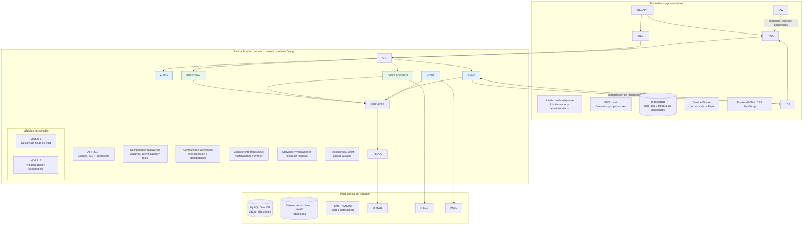
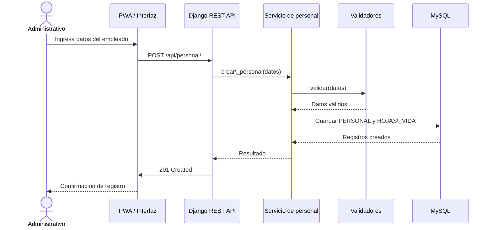
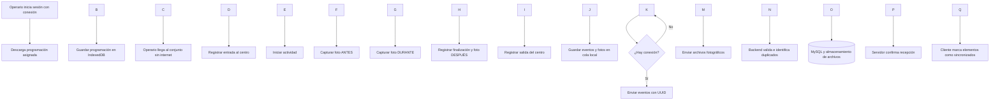

# Guía de arquitectura y prompt de implementación

## Sistema de gestión de mantenimiento locativo

**Propósito:** entregar al equipo una guía única para construir la aplicación respetando el Informe Parcial 2, la arquitectura seleccionada y los dos módulos funcionales exigidos por el taller.

\---

## 1\. Alcance que debe respetar la implementación

El taller exige seleccionar e implementar **mínimo dos módulos funcionales** y demostrar mediante su funcionamiento la aplicación de principios de arquitectura de software. Los dos módulos acordados son:

1. **Gestión de hojas de vida del personal.**
2. **Programación y seguimiento de actividades laborales.**

No deben convertirse en dos aplicaciones independientes. Se construirán dentro de **una sola aplicación monolítica modular**.

### Actores y usuarios contemplados

* 1 administrador de la empresa.
* 20 administrativos.
* 150 operarios.
* Aproximadamente 30 supervisores.
* Total estimado: 201 usuarios.

### Necesidades principales

* El administrador crea y publica la programación semanal.
* Cada operario tiene correo institucional y recibe su programación.
* Se asignan actividades, operarios, supervisores y centros de trabajo (conjuntos residenciales).
* El operario registra cuatro marcas de tiempo: entrada al centro, inicio de actividad, finalización de actividad y salida del centro.
* Cada actividad requiere fotografías del antes, durante y después.
* El supervisor revisa presencialmente el trabajo y lo aprueba o rechaza con observaciones.
* Los operarios utilizan celulares personales de gama baja o media y pueden trabajar sin conectividad.
* Cuando vuelve la conexión, se sincronizan registros y fotografías con el servidor.

**Importante:** el seguimiento central se actualiza cuando los dispositivos sincronizan. No se debe prometer visibilidad en tiempo real mientras el dispositivo permanezca desconectado.

\---

## 2\. Decisión arquitectónica

* **Estilo:** monolito modular.
* **Organización:** arquitectura en tres capas: presentación, lógica de negocio y acceso a datos.
* **Patrón de presentación:** organización MVC como referencia conceptual. Django utiliza MTV (Modelo–Plantilla–Vista); si se expone una API con Django REST Framework, las API Views/Views gestionan las solicitudes y los servicios contienen la lógica de negocio. No afirmar que Django implementa MVC literalmente.
* **Base de datos central:** MySQL con InnoDB.
* **Backend propuesto:** Python 3.12 o superior y Django 5.x, según la propuesta del informe.
* **API:** Django REST Framework.
* **Cliente:** PWA ligera con HTML, CSS y JavaScript.
* **Almacenamiento local offline:** IndexedDB.
* **Sincronización:** API REST con UUID por evento, reintentos e idempotencia.
* **Fotografías:** archivos fuera de MySQL; en MySQL se guardan ruta y metadatos. En local se puede usar el sistema de archivos; MinIO compatible con S3 queda como alternativa detrás de una interfaz.
* **Correo:** SMTP; Mailpit para pruebas locales. Procesamiento asíncrono mediante una cola persistida en la tabla de notificaciones y un worker de Django.
* **Pruebas:** pytest y utilidades de pruebas de Django.

Los componentes `accounts`, `synchronization`, `notifications` y `common` son **componentes transversales/de soporte**. No son módulos funcionales adicionales que sustituyan los dos módulos exigidos.

\---

## 3\. Diagrama Mermaid de la arquitectura general

Pegar este bloque en [Mermaid Live Editor](https://mermaid.live/):



\---

## 4\. Diagrama Mermaid de los módulos y sus responsabilidades

```mermaid
flowchart TB
    SISTEMA\[ Sistema de gestión de mantenimiento locativo ]

    SISTEMA --> M1\[Módulo 1: Gestión de hojas de vida]
    SISTEMA --> M2\[Módulo 2: Programación y seguimiento]
    SISTEMA --> TRANS\[Componentes transversales]

    M1 --> M11\[Registrar y consultar personal]
    M1 --> M12\[Crear y actualizar hoja de vida]
    M1 --> M13\[Consultar información laboral]

    M2 --> M21\[Crear y publicar programación semanal]
    M2 --> M22\[Asignar operario, actividad y conjunto]
    M2 --> M23\[Registrar entrada y salida del centro]
    M2 --> M24\[Registrar inicio y fin de actividad]
    M2 --> M25\[Capturar evidencias: antes, durante y después]
    M2 --> M26\[Revisar, aprobar o rechazar trabajo]

    TRANS --> T1\[Autenticación y permisos por rol]
    TRANS --> T2\[Sincronización offline]
    TRANS --> T3\[Notificaciones por correo]
    TRANS --> T4\[Almacenamiento de fotografías]

    classDef module fill:#e8f5e9,stroke:#2e7d32,color:#1b5e20;
    class M1,M2 module;
```



\---

## 5\. Estructura propuesta de carpetas y archivos

La estructura usa una sola aplicación Django en el backend y un frontend PWA separado. Las carpetas `personal` y `operations` corresponden a los dos módulos funcionales acordados.

```text
sistema\_gestion\_mantenimiento/
│
├── backend/
│   ├── manage.py
│   ├── requirements.txt
│   ├── .env.example
│   │
│   ├── config/
│   │   ├── \_\_init\_\_.py
│   │   ├── settings.py
│   │   ├── urls.py
│   │   ├── asgi.py
│   │   └── wsgi.py
│   │
│   └── apps/
│       ├── accounts/                 # Componente transversal
│       │   ├── apps.py
│       │   ├── models.py
│       │   ├── services.py
│       │   ├── permissions.py
│       │   ├── serializers.py
│       │   ├── views.py
│       │   ├── urls.py
│       │   └── tests/
│       │
│       ├── personal/                 # MÓDULO FUNCIONAL 1
│       │   ├── apps.py
│       │   ├── models.py
│       │   ├── repositories.py
│       │   ├── services.py
│       │   ├── validators.py
│       │   ├── serializers.py
│       │   ├── views.py
│       │   ├── urls.py
│       │   ├── migrations/
│       │   └── tests/
│       │
│       ├── operations/               # MÓDULO FUNCIONAL 2
│       │   ├── apps.py
│       │   ├── models.py
│       │   ├── repositories.py
│       │   ├── services.py
│       │   ├── validators.py
│       │   ├── serializers.py
│       │   ├── views.py
│       │   ├── urls.py
│       │   ├── migrations/
│       │   └── tests/
│       │
│       ├── synchronization/          # Componente transversal
│       │   ├── apps.py
│       │   ├── models.py
│       │   ├── services.py
│       │   ├── serializers.py
│       │   ├── views.py
│       │   ├── urls.py
│       │   └── tests/
│       │
│       ├── notifications/            # Componente transversal
│       │   ├── apps.py
│       │   ├── models.py
│       │   ├── interfaces.py
│       │   ├── adapters.py
│       │   ├── services.py
│       │   ├── management/
│       │   │   └── commands/
│       │   │       └── process\_notifications.py
│       │   └── tests/
│       │
│       └── common/                   # Utilidades compartidas
│           ├── interfaces.py
│           ├── exceptions.py
│           └── utilities.py
│
├── frontend/
│   ├── index.html
│   ├── manifest.json
│   ├── service-worker.js
│   ├── assets/
│   │   ├── images/
│   │   └── icons/
│   ├── src/
│   │   ├── app.js
│   │   ├── router.js
│   │   ├── shared/
│   │   │   ├── api/api-client.js
│   │   │   ├── auth/auth.js
│   │   │   ├── database/indexeddb.js
│   │   │   ├── offline/sync-manager.js
│   │   │   ├── offline/sync-queue.js
│   │   │   ├── camera/photo-compressor.js
│   │   │   └── components/
│   │   ├── modules/
│   │   │   ├── personal/
│   │   │   │   ├── pages/
│   │   │   │   ├── components/
│   │   │   │   └── personal.js
│   │   │   └── operations/
│   │   │       ├── admin/
│   │   │       ├── operator/
│   │   │       ├── supervisor/
│   │   │       └── operations.js
│   │   └── styles/main.css
│   └── tests/
│
├── storage/
│   └── evidences/                    # Archivos de evidencia en desarrollo local
│
├── database/
│   └── init.sql                      # Solo inicialización de BD/charset, si aplica
│
├── docs/
│   ├── arquitectura/
│   ├── diagramas/
│   └── manuales/
│
├── docker-compose.yml
├── .gitignore
└── README.md
```

### Responsabilidad por carpeta

|Carpeta|Responsabilidad|
|-|-|
|`accounts/`|Usuarios, autenticación, roles y permisos.|
|`personal/`|Datos del personal y hojas de vida. Es el módulo funcional 1.|
|`operations/`|Programación, asignaciones, horarios, ejecuciones, evidencias y revisiones. Es el módulo funcional 2.|
|`synchronization/`|Recepción de registros offline, control de UUID, reintentos e idempotencia.|
|`notifications/`|Envío de programación por correo y registro de estados/reintentos.|
|`common/`|Contratos, excepciones y utilidades compartidas, sin lógica específica de los módulos.|
|`frontend/src/shared/`|Cliente API, autenticación, IndexedDB, cola offline y compresión de imágenes.|
|`storage/evidences/`|Archivos fotográficos en entorno local; no se versionan en Git.|

\---

## 6\. Ubicación de las entidades del ERD

Mantener correspondencia entre el modelo relacional del punto 7 y las aplicaciones Django:

|Entidad del ERD|Aplicación Django sugerida|
|-|-|
|PERSONAL|`personal`|
|HOJAS\_VIDA|`personal`|
|USUARIOS|`accounts` (usuario personalizado relacionado con PERSONAL)|
|ROLES|`accounts`|
|USUARIOS\_ROLES|`accounts`|
|CENTROS\_TRABAJO|`operations`|
|TIPOS\_ACTIVIDAD|`operations`|
|PROGRAMACIONES|`operations`|
|ASIGNACIONES|`operations`|
|REGISTROS\_CENTRO|`operations`|
|EJECUCIONES|`operations`|
|EVIDENCIAS|`operations`|
|REVISIONES|`operations`|
|NOTIFICACIONES|`notifications`|
|DISPOSITIVOS|`synchronization`|
|SINCRONIZACIONES|`synchronization`|

**Decisión técnica temprana:** definir el modelo de usuario personalizado de Django antes de ejecutar las primeras migraciones. Configurar `AUTH\_USER\_MODEL` desde el inicio para evitar una migración compleja posterior. No duplicar innecesariamente la tabla de usuarios de Django y la entidad USUARIOS del ERD: diseñar una única correspondencia coherente.

\---

## 7\. Flujo Mermaid: registro de una hoja de vida



\---

## 8\. Flujo Mermaid: trabajo offline y sincronización



**Reglas del flujo:**

* La programación publicada por el servidor es la fuente de verdad; el cliente la consulta y conserva una copia local.
* Cada evento generado offline recibe un UUID en el dispositivo.
* Los endpoints de sincronización deben ser idempotentes: reenviar un UUID ya procesado no crea un duplicado.
* Enviar primero los metadatos/eventos necesarios y luego las fotografías, manteniendo la relación entre ejecución y evidencias.
* Confirmar cada elemento recibido y permitir reintentar lo que falló.
* La aplicación no debe borrar la copia local pendiente hasta contar con confirmación del servidor.
* No depender exclusivamente de Background Sync: en navegadores móviles puede ser limitado. También intentar sincronizar al abrir la aplicación o cuando vuelva la conexión.
* Guardar la hora local de captura y la hora de recepción del servidor. Marcar para revisión los relojes con desfase superior al umbral definido en el informe (5 minutos).
* Las marcas de tiempo y evidencias deben tratarse como eventos trazables; no sobrescribir silenciosamente registros ya sincronizados.

\---

## 9\. Alcance funcional mínimo para demostrar los dos módulos

### Módulo 1: Gestión de hojas de vida

Debe permitir, como mínimo:

1. Crear el registro de un empleado/operario.
2. Registrar la información de su hoja de vida.
3. Consultar el listado y el detalle de empleados.
4. Actualizar información.
5. Validar documento y correo para evitar duplicados.
6. Restringir las operaciones según los roles autorizados.

**Demostración mínima:** crear un operario, consultar su ficha, actualizar un dato y comprobar que persiste en MySQL.

### Módulo 2: Programación y seguimiento

Debe permitir construir un flujo vertical demostrable:

1. Crear una programación semanal.
2. Asignar al menos un operario, actividad, centro de trabajo y supervisor.
3. Consultar la asignación desde el usuario operario.
4. Registrar entrada al centro e inicio de actividad.
5. Capturar las evidencias ANTES, DURANTE y DESPUÉS.
6. Registrar finalización de actividad y salida del centro.
7. Permitir que el supervisor consulte la ejecución y registre aprobación o rechazo con observaciones.
8. Mantener historial de intentos si se rechaza y se vuelve a ejecutar el trabajo.

**Demostración mínima:** programar una actividad, consultarla con el perfil del operario, registrar su ejecución con evidencias y finalizar con una revisión del supervisor.

### Integración offline

Después del flujo online básico, demostrar progresivamente:

1. Descargar la programación con conexión.
2. Desactivar la conexión del dispositivo.
3. Registrar horarios y evidencias.
4. Comprobar que quedan en IndexedDB.
5. Restablecer conexión.
6. Sincronizar y comprobar los registros en MySQL y los archivos en almacenamiento del servidor.
7. Repetir un envío para comprobar que no duplica los registros.

\---

## 10\. Principios arquitectónicos que se deben evidenciar en el código

|Principio|Evidencia esperada|
|-|-|
|Encapsulación|Las entidades se modifican mediante servicios y operaciones autorizadas; no se exponen escrituras arbitrarias.|
|Bajo acoplamiento|Los módulos se relacionan mediante contratos claros y no acceden a los detalles internos del otro módulo.|
|Alta cohesión|Cada aplicación Django concentra responsabilidades relacionadas.|
|DRY|Validaciones y funciones compartidas se reutilizan; no duplicar lógica.|
|Separation of Concerns|Presentación, negocio y persistencia separados.|
|SRP|Cada clase, servicio o componente tiene una responsabilidad concreta.|
|OCP|Los proveedores de correo y almacenamiento pueden cambiarse mediante adaptadores.|
|DIP|El negocio depende de interfaces/contratos, no de implementaciones concretas de SMTP o almacenamiento.|
|KISS|No agregar microservicios, brokers ni infraestructura que no sean necesarios para el alcance.|

\---

# 11\. Prompt maestro para el compañero que implementará el sistema

Copia el siguiente prompt completo y entrégaselo al compañero o a su asistente de programación. Debe trabajar **por fases y por módulo**, no generar todo el sistema de una vez.

```text
Actúa como arquitecto de software y desarrollador senior especializado en Python,
Django, Django REST Framework, MySQL y aplicaciones web progresivas (PWA).

Necesito implementar un proyecto académico llamado:
Sistema de Gestión de Mantenimiento Locativo.

CONTEXTO DEL PROYECTO
La empresa presta servicios de mantenimiento en conjuntos residenciales:
piscinas, pintura, jardinería y otros trabajos locativos. El sistema coordina:
- 1 administrador de la empresa.
- 20 administrativos.
- 150 operarios.
- Aproximadamente 30 supervisores.
Total estimado: 201 usuarios.

El administrador publica una programación semanal y cada operario recibe
la programación en su correo institucional. Cada asignación identifica operario,
actividad, centro de trabajo y, cuando corresponda, supervisor.

El operario debe poder:
- Consultar su programación.
- Registrar hora de entrada al centro de trabajo.
- Registrar inicio de la actividad.
- Registrar finalización de la actividad.
- Registrar salida del centro de trabajo.
- Capturar una fotografía ANTES, DURANTE y DESPUÉS de cada actividad.

El supervisor revisa presencialmente el trabajo y lo aprueba o rechaza con
observaciones. Si se rechaza, el operario debe poder realizar otro intento y el
sistema debe conservar el historial.

RESTRICCIÓN PRINCIPAL
Los operarios usan celulares personales de gama baja o media y pueden no tener
internet ni datos móviles en los conjuntos. La aplicación debe permitir guardar
programación, horarios, eventos y fotografías localmente, y sincronizarlos al
recuperar la conexión.

OBJETIVO ACADÉMICO
El taller exige implementar mínimo dos módulos funcionales y demostrar principios
de arquitectura de software. Los dos módulos son:
1. Gestión de hojas de vida del personal.
2. Programación y seguimiento de actividades laborales.

DECISIÓN ARQUITECTÓNICA OBLIGATORIA
- Una sola aplicación: monolito modular, no microservicios.
- Organización en tres capas: presentación, lógica de negocio y acceso a datos.
- MVC como referencia conceptual. Django usa MTV; no afirmar que Django implementa
  MVC literalmente. Separar API Views/serializers, servicios de negocio y persistencia.
- Backend propuesto: Python 3.12+ y Django 5.x.
- API: Django REST Framework.
- Base de datos central: MySQL con InnoDB.
- Autenticación: JWT con tokens de acceso/renovación y contraseñas con Argon2,
  de acuerdo con los requisitos del informe.
- Cliente: PWA ligera en HTML, CSS y JavaScript.
- Offline: IndexedDB y Service Worker.
- Sincronización: API REST, UUID generados por el cliente, idempotencia, reintentos
  y confirmaciones del servidor.
- Fotografías: archivos fuera de MySQL. Guardar en MySQL solamente la ruta y
  metadatos. Usar una interfaz para permitir sistema de archivos local o MinIO.
- Correo: SMTP; Mailpit en desarrollo/pruebas. La tabla de notificaciones será una
  cola persistente y un worker de Django procesará envíos con reintentos.
- Pruebas: pytest y herramientas de Django.

ESTRUCTURA MODULAR
Crear una sola aplicación backend con estas apps Django:
- accounts: usuarios, autenticación, roles y permisos (transversal).
- personal: módulo funcional 1, datos del personal y hojas de vida.
- operations: módulo funcional 2, centros, tipos de actividad, programaciones,
  asignaciones, asistencia, ejecuciones, evidencias y revisiones.
- synchronization: dispositivos y procesos de sincronización (transversal).
- notifications: notificaciones y worker de correo (transversal).
- common: interfaces, excepciones y utilidades compartidas.

El frontend PWA tendrá:
- shared/api: cliente para consumir la API.
- shared/auth: gestión de sesión y autorización en la interfaz.
- shared/database: IndexedDB.
- shared/offline: cola y coordinador de sincronización.
- shared/camera: compresión de imágenes.
- modules/personal: pantallas del módulo 1.
- modules/operations: pantallas de administrador, operario y supervisor.

MODELO DE DATOS
Respetar el ERD acordado y mantener la correspondencia de estas entidades:
PERSONAL, HOJAS\_VIDA, USUARIOS, ROLES, USUARIOS\_ROLES,
CENTROS\_TRABAJO, TIPOS\_ACTIVIDAD, PROGRAMACIONES, ASIGNACIONES,
REGISTROS\_CENTRO, EJECUCIONES, EVIDENCIAS, REVISIONES,
NOTIFICACIONES, DISPOSITIVOS y SINCRONIZACIONES.

Decisiones específicas:
- Un empleado puede tener una hoja de vida opcional en el modelo, pero un operario
  no debe habilitarse para recibir asignaciones sin completar su hoja de vida.
- Una asignación puede tener varias ejecuciones. Incluir numero\_intento y la
  restricción UNIQUE(asignacion\_id, numero\_intento).
- Cada ejecución debe tener al menos una evidencia de cada etapa: ANTES, DURANTE
  y DESPUES, antes de enviarla a revisión. Aplicar esta regla en la lógica de negocio.
- Una ejecución puede tener varias revisiones; conservar el historial.
- Las revisiones pueden sincronizarse desde el dispositivo cuando el diseño de la
  operación del supervisor requiera trabajo sin conexión.
- Cada evento local debe tener UUID único. El servidor debe ser idempotente.
- No guardar imágenes directamente en columnas de MySQL.
- Definir el usuario personalizado de Django y AUTH\_USER\_MODEL antes de las
  primeras migraciones. No duplicar el usuario de Django y USUARIOS sin una
  correspondencia clara con el ERD.

REGLAS DE ARQUITECTURA Y CALIDAD
1. Mantener bajo acoplamiento y alta cohesión.
2. Aplicar SRP, DRY, SoC, encapsulación, DIP, OCP y KISS cuando corresponda.
3. Las vistas/controladores no deben contener reglas complejas de negocio.
4. La lógica de negocio debe ubicarse en services.py o servicios/clases dedicados.
5. Validar permisos en el backend; ocultar botones en frontend no es seguridad.
6. El frontend no debe conectarse directamente a MySQL.
7. No almacenar secretos en el repositorio. Usar .env y entregar .env.example
   con valores ficticios.
8. No versionar fotografías, archivos .env ni datos personales reales.
9. La programación central del servidor es la fuente de verdad.
10. No depender exclusivamente de Background Sync del navegador: intentar sincronizar
    al abrir la aplicación y al detectar conectividad, con reintentos controlados.
11. Registrar hora de captura local y hora de recepción del servidor. Marcar registros
    cuyo reloj local tenga un desfase superior a 5 minutos respecto al servidor.
12. No afirmar que hay tiempo real cuando el operario no tiene conexión. La información
    central se actualiza cuando el dispositivo sincroniza.

FORMA DE TRABAJO OBLIGATORIA: IMPLEMENTAR POR FASES
No generes todo el proyecto de una sola vez. Trabaja en incrementos pequeños,
verificables y fáciles de revisar.

FASE 0 — INSPECCIÓN Y PLAN
- Primero inspecciona el repositorio y los archivos que ya existen.
- No sobrescribas ni elimines trabajo previo.
- Identifica lenguaje, estructura, dependencias y estado de Git.
- Compara lo existente con la arquitectura descrita.
- Entrega un plan de implementación y lista de archivos que crearás/modificarás.
- Si el repositorio ya tiene decisiones incompatibles, explícitalas antes de cambiar.

FASE 1 — FUNDACIÓN DEL PROYECTO
- Crear/configurar Django, settings por entorno, conexión MySQL e InnoDB.
- Configurar Django REST Framework.
- Definir usuario personalizado, roles, permisos y JWT desde el comienzo.
- Crear estructura modular y endpoint de salud.
- Preparar .env.example, .gitignore, README y Docker Compose si es necesario.
- Ejecutar migraciones y pruebas iniciales.
- No empezar el módulo 2 antes de que la base esté verificada.

FASE 2 — MÓDULO 1: GESTIÓN DE HOJAS DE VIDA
- Implementar PERSONAL y HOJAS\_VIDA según el ERD.
- Implementar registro, consulta, detalle y actualización.
- Validar documento/correo únicos y reglas de campos obligatorios.
- Implementar permisos para administrador y administrativos; otros roles solo
  tendrán las consultas expresamente autorizadas.
- Crear endpoints REST, serializers, servicios y repositorios cuando aporten valor.
- Crear pruebas de modelo, servicios, API, validaciones y permisos.
- Entregar instrucciones para ejecutar y demostrar el módulo.
- No pasar a la siguiente fase hasta que el módulo sea funcional y probado.

FASE 3 — MÓDULO 2: PROGRAMACIÓN Y SEGUIMIENTO ONLINE
- Implementar centros de trabajo y tipos de actividad.
- Crear programación semanal y asignaciones.
- Permitir al operario consultar solo sus asignaciones.
- Implementar registros de entrada/salida del centro e inicio/fin de actividad.
- Implementar captura y carga de evidencias ANTES, DURANTE y DESPUES.
- Implementar revisión presencial y aprobación/rechazo con observaciones.
- Permitir nuevos intentos después de un rechazo, conservando ejecuciones y revisiones.
- Implementar notificaciones de programación con cola persistente y worker.
- Crear pruebas de reglas de negocio, permisos, estados y relaciones.
- Entregar instrucciones y datos ficticios para demostrar el flujo completo.

FASE 4 — PWA Y FUNCIONAMIENTO OFFLINE
- Crear manifest y Service Worker.
- Implementar IndexedDB para programación descargada, eventos pendientes y fotos.
- Comprimir imágenes en el cliente antes de guardarlas/enviarlas, cuidando la calidad.
- Crear cola de sincronización con UUID.
- Crear endpoint idempotente en backend.
- Enviar eventos y fotografías; registrar confirmación individual y permitir reintentos.
- No borrar de IndexedDB registros/fotos sin confirmación del servidor.
- Probar desconexión, cierre/reapertura de la aplicación, conexión intermitente,
  reenvío del mismo UUID y recuperación tras un fallo parcial.
- Si la sincronización en segundo plano no está disponible, sincronizar al abrir
  la PWA o al detectar conexión.

FASE 5 — PRUEBAS, INTEGRACIÓN Y DEMOSTRACIÓN
- Ejecutar pruebas automatizadas.
- Verificar el aislamiento de roles.
- Verificar que no se dupliquen eventos al reintentar sincronización.
- Verificar que no se pueda enviar a revisión una ejecución sin las tres etapas
  fotográficas.
- Verificar la trazabilidad de horarios, evidencias e intentos rechazados.
- Documentar cómo ejecutar backend, frontend, MySQL, Mailpit y almacenamiento.
- Preparar un guion de demostración de los dos módulos.

FORMATO DE ENTREGA AL FINAL DE CADA FASE
1. Resumen de lo implementado.
2. Archivos creados y modificados.
3. Decisiones técnicas tomadas y su relación con la arquitectura.
4. Comandos para instalar, migrar, ejecutar y probar.
5. Resultado real de las pruebas ejecutadas; nunca inventar que una prueba pasó.
6. Problemas pendientes y riesgos.
7. Próximo paso sugerido.

REGLAS IMPORTANTES
- No inventes requisitos ni entidades sin justificarlo.
- Si el ERD y el código existente difieren, explica la diferencia y propone el ajuste.
- No conviertas la solución en microservicios.
- No mezcles lógica de negocio en las vistas ni consultas SQL directas desde el frontend.
- No reemplaces archivos existentes sin revisar su contenido.
- No incluyas credenciales reales en el código, ejemplos o commits.
- No hagas commits ni pushes sin autorización explícita del equipo.
- Antes de cerrar una fase, ejecuta y reporta las pruebas pertinentes.
- Prioriza una versión mínima funcional de cada uno de los dos módulos antes de
  ampliar características secundarias.

COMIENZA ÚNICAMENTE CON LA FASE 0: inspecciona el repositorio, informa qué existe,
compara con esta arquitectura y presenta el plan de trabajo. No implementes todavía
cambios de código hasta entregar ese diagnóstico.
```

\---

## 12\. Prompts cortos para continuar por fase

Después de que el compañero entregue el diagnóstico de la Fase 0, puede usar estos mensajes uno por uno:

### Para la Fase 1

```text
Implementa ahora únicamente la Fase 1 del prompt maestro: fundación Django,
configuración MySQL, usuario personalizado, roles, JWT, estructura modular y endpoint
de salud. No implementes todavía los dos módulos. Ejecuta migraciones y pruebas,
y documenta los comandos y resultados.
```

### Para la Fase 2

```text
Implementa únicamente el Módulo 1: Gestión de hojas de vida. Sigue el ERD y la
arquitectura acordada. Incluye modelos, migraciones, servicios, validaciones,
serializers, endpoints, permisos y pruebas. Al terminar, demuestra crear, consultar
y actualizar un operario. No empieces el Módulo 2 hasta entregar los resultados.
```

### Para la Fase 3

```text
Implementa únicamente el Módulo 2: Programación y seguimiento online. Construye
el flujo vertical: crear programación, asignar operario/centro/actividad/supervisor,
consultar asignación, registrar cuatro marcas de tiempo, cargar tres evidencias,
y aprobar o rechazar con observaciones. Si hay rechazo, permitir otro intento y
conservar el historial. Incluye pruebas y demostración. Todavía no implementes
la sincronización offline completa.
```

### Para la Fase 4

```text
Implementa el funcionamiento offline-first de la PWA: Service Worker, IndexedDB,
cola local, UUID por evento, compresión fotográfica, sincronización idempotente,
confirmaciones, reintentos y recuperación de fallos parciales. Prueba el flujo con
la red desconectada y restablecida. No elimines datos locales hasta recibir
confirmación del servidor.
```

### Para la Fase 5

```text
Ejecuta la integración y las pruebas finales de ambos módulos. Verifica roles,
permisos, integridad de datos, fotografías obligatorias, historial de rechazos,
sincronización sin duplicados y notificaciones. Prepara datos ficticios y un guion
para demostrar los dos módulos al docente. Reporta solamente resultados realmente
comprobados.
```

\---

## 13\. Criterio de aceptación del trabajo

El proyecto estará listo para la demostración académica cuando:

* Los dos módulos funcionales estén implementados y conectados a MySQL.
* Los cuatro roles tengan permisos diferenciados.
* Se pueda completar un flujo de hoja de vida de principio a fin.
* Se pueda completar un flujo de programación, ejecución, evidencias y supervisión.
* La PWA conserve registros y fotografías sin conexión y los sincronice sin duplicados.
* Las pruebas principales estén ejecutadas y documentadas.
* El equipo pueda explicar dónde se aplican bajo acoplamiento, alta cohesión, SRP, DRY, SoC y DIP.

**Principio de trabajo:** primero construir una versión funcional, pequeña y probada de cada módulo; después completar las capacidades offline y las mejoras. Mantener siempre la implementación alineada con los puntos 5, 6, 7, 8, 9, 10 y 11 del informe.

